<picture>
  <source media="(prefers-color-scheme: dark)" srcset="assets/dark/header.svg"/>
  
</picture>

<picture>
  <source media="(prefers-color-scheme: dark)" srcset="assets/dark/cards.svg"/>
  
</picture>

<picture>
  <source media="(prefers-color-scheme: dark)" srcset="assets/dark/divider.svg"/>
  
</picture>

### tools of choice

<picture>
  <source media="(prefers-color-scheme: dark)" srcset="https://skillicons.dev/icons?i=linux,nix,git,bash,python,ts,rust,docker&theme=dark"/>
  
</picture>

<picture>
  <source media="(prefers-color-scheme: dark)" srcset="assets/dark/divider.svg"/>
  
</picture>

### activity

<picture>
  <source media="(prefers-color-scheme: dark)" srcset="https://github-readme-stats.vercel.app/api?username=eximora-private&show_icons=true&count_private=true&bg_color=211F26&title_color=D0BCFF&text_color=CAC4D0&icon_color=EFB8C8&ring_color=D0BCFF&border_radius=28&hide_border=true"/>
  
</picture>
<picture>
  <source media="(prefers-color-scheme: dark)" srcset="https://github-readme-stats.vercel.app/api/top-langs/?username=eximora-private&layout=compact&bg_color=211F26&title_color=D0BCFF&text_color=CAC4D0&icon_color=EFB8C8&ring_color=D0BCFF&border_radius=28&hide_border=true"/>
  
</picture>

<picture>
  <source media="(prefers-color-scheme: dark)" srcset="https://streak-stats.demolab.com?user=eximora-private&background=211F26&ring=D0BCFF&fire=EFB8C8&currStreakNum=E6E0E9&currStreakLabel=D0BCFF&sideNums=E6E0E9&sideLabels=CAC4D0&dates=CAC4D0&stroke=49454F&border_radius=28&hide_border=true"/>
  
</picture>

<picture>
  <source media="(prefers-color-scheme: dark)" srcset="https://raw.githubusercontent.com/eximora-private/eximora-private/output/snake-dark.svg"/>
  
</picture>

<picture>
  <source media="(prefers-color-scheme: dark)" srcset="assets/dark/footer.svg"/>
  
</picture>

